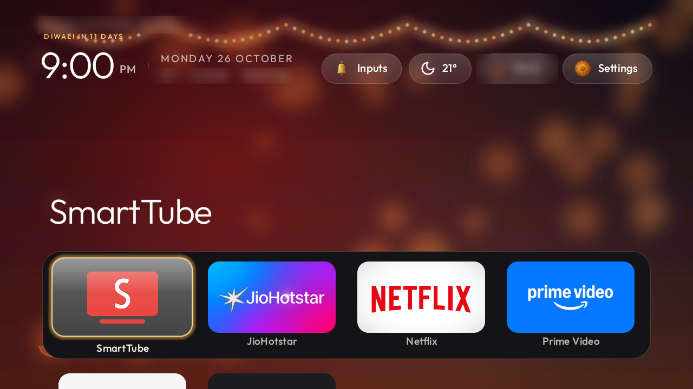
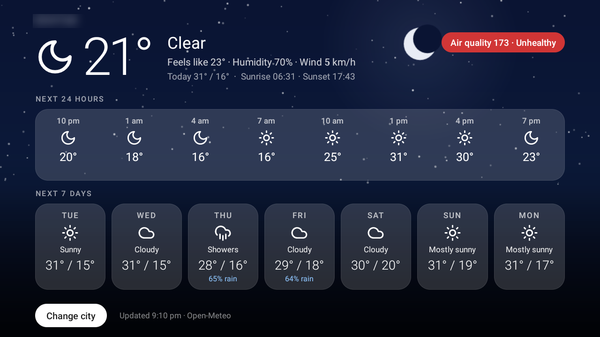
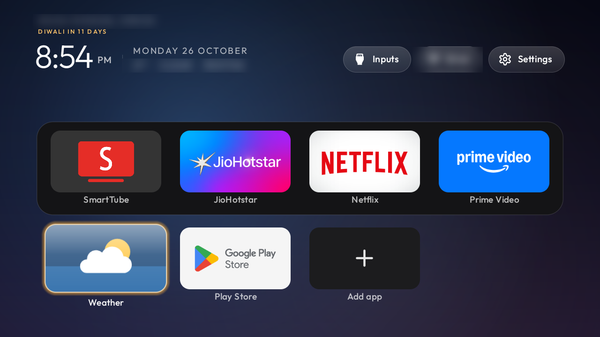
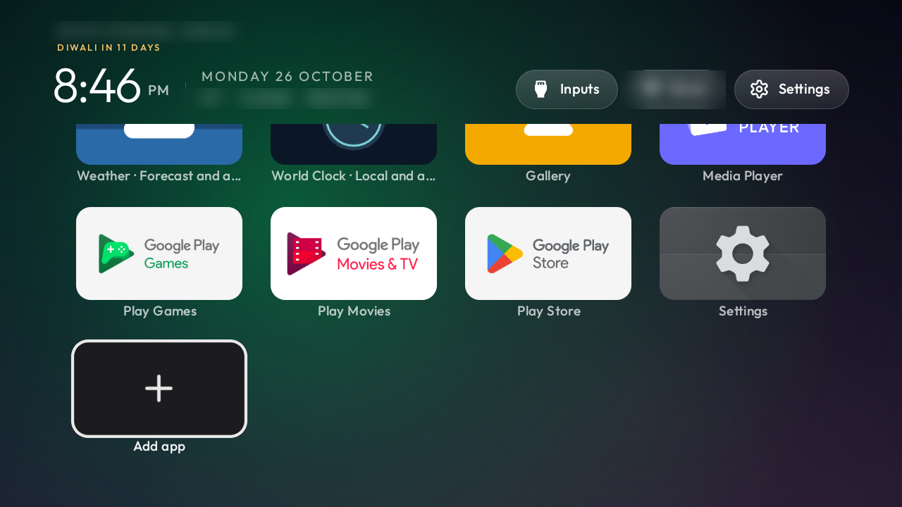
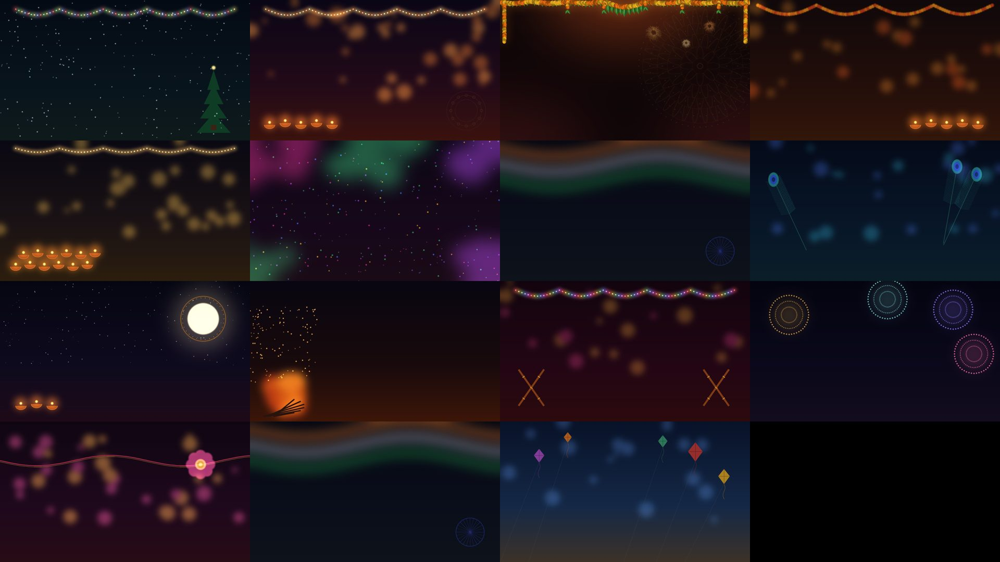

# OpenTV OS

**A clean, ad-free home screen for Google TV and Android TV, set up from a Windows PC in one double-click.**

No root, no cable, nothing uninstalled, and one double-click to undo. Built on
[CleanYourTV](https://github.com/Gathin23/cleanyourtv) (MIT), with extra features made for Indian homes.

| Home during Diwali | The new Weather app |
|---|---|
|  |  |
|  |  |

## What you get

| | |
|---|---|
| **No ads, no tracking** | Sponsored rows, PatchWall, partner auto-installs and analytics turned off (disabled, never deleted) |
| **A clean home screen** | Apple TV style dock, big tiles with names, an **+ Add app** tile, hold OK on a tile to move or remove it |
| **Your name** | "Good evening, *your name*" |
| **Indian festivals, automatic** | Diwali, Holi, Lohri, Makar Sankranti, Raksha Bandhan, Janmashtami, Ganesh Chaturthi, Navratri, Dussehra, Karwa Chauth, Gurpurab, Republic Day, Independence Day, Christmas and New Year. Each shows 14 days before and after (national days: 3 before, 1 after) with its own wallpaper, colour, diya/bell/marigold icons and a countdown ("Diwali in 5 days") under your name |
| **Live weather for your city** | A weather pill in the top bar (icon + temperature), the sky tinted by the weather, and a full Weather app with the next 24 hours and 7 days |
| **YouTube without ads** | [SmartTube](https://github.com/yuliskov/SmartTube) (official release, SHA-256 checked) replaces YouTube; YouTube links and search open in it, and the remote's YouTube button opens it from Home |
| **Remote that still feels right** | Held Volume ramps normally in every app; Netflix and Prime buttons keep working; the **Remote Buttons** app lets you change what an app button opens |
| **Phone as a remote** | The free Google TV app on your phone keeps working |

## Install (about 15 minutes)

### 1. On the TV
1. **Settings → Device Preferences → About** → press **OK** on **Build** 7 times ("You are now a developer").
2. Back → **Developer options** → turn on **USB debugging** (and **Network debugging** if you see it).
3. **Settings → Network & Internet →** your Wi-Fi → note the **IP address** (like `192.168.1.12`).

### 2. On your Windows PC (same Wi-Fi as the TV)
1. Go to **[Releases](../../releases/latest)** and download **`OpenTV-OS.zip`**.
2. Right-click it → **Extract All**.
3. Open the folder and **double-click `Setup-My-TV.bat`**. If Windows shows "Windows protected your PC", choose **More info → Run anyway**.
4. Type **your name**, **your city** and the **TV's IP address**.
5. On the TV, choose **Always allow** and **OK** on "Allow USB debugging?".
6. Answer the questions (which apps to keep, and so on). Press Enter to take the suggested answer.
7. At the end, let it turn TV debugging off. Then, on the TV: **Developer options → Revoke USB debugging authorisations**.

On the TV afterwards: open **Weather** once and pick your city, and add cities in **World Clock** if you like.

### Undo everything
Double-click **`Restore-My-TV.bat`** (turn USB debugging on again first). Everything that was turned off comes back,
and Home goes back to the TV's own launcher.

## Which TVs

| TV | Works |
|---|---|
| Google TV / Android TV (Xiaomi, Redmi, Sony, TCL, OnePlus, Hisense, Vu, Acer, Nokia, ...) Android 8 or later | Yes. Tested on Xiaomi MiTV-AXFR2 (Google TV, Android 11) |
| Fire TV, Samsung (Tizen), LG (webOS) | No |

The app list in `lists/debloat.json` was tested on Xiaomi; on other brands only the entries the TV has are used.

## Good to know

- **Nothing is uninstalled.** Apps are disabled, and every change is written to `backup\` so Restore can undo it.
- **Storage:** if the TV is nearly full, setup clears app caches (never your data) so the apps fit.
- **Debugging:** keep it **off** when you are not using the PC with the TV. While it is on, the TV can be
  controlled from your Wi-Fi. `Close-TV-Debugging.bat` turns it off and checks it.
- **Network:** the home screen talks only to [Open-Meteo](https://open-meteo.com) (free weather, no account) with your
  city's latitude and longitude; setup also downloads Google's adb and SmartTube from their official sites.
- **YouTube button:** on Google TV this button belongs to the Google TV home, which is turned off, so it opens SmartTube
  only from the OpenTV Home screen. Inside apps, Volume is left completely alone so holding it ramps normally.
- More details, every problem we hit and the fix: **[docs/GUIDE.md](docs/GUIDE.md)**.

## What's inside

| Path | What |
|---|---|
| `Setup-My-TV.bat`, `Restore-My-TV.bat`, `Close-TV-Debugging.bat` | The three things to double-click |
| `scripts/` | The PowerShell behind them (readable, no hidden steps) |
| `apps/` | Ready-built apps, in the Release zip: OpenTV home screen, Weather, World Clock, Remote Buttons |
| `theme/` | The look: `config.json` (dock, festivals, weather, remote) and the 15 festival wallpapers |
| `lists/debloat.json` | What can be turned off, grouped, with a reason for each |
| `source/` | All code changes on top of CleanYourTV, and how to build the apps yourself |

## Credits and licence

OpenTV OS is MIT licensed ([LICENSE](LICENSE)). It is built on **[CleanYourTV](https://github.com/Gathin23/cleanyourtv)**
by Gathin and its contributors (MIT): the launcher, the Weather add-on by Sumyabazar1 and the World Clock add-on by
savioronezero. Icons follow [Lucide](https://lucide.dev) (ISC). The Outfit font is under the SIL Open Font Licence.
SmartTube is downloaded from its own releases and is not part of this repo. See [CREDITS.md](CREDITS.md).
OpenTV OS is a personal project and is not affiliated with Google, Xiaomi or CleanYourTV.
